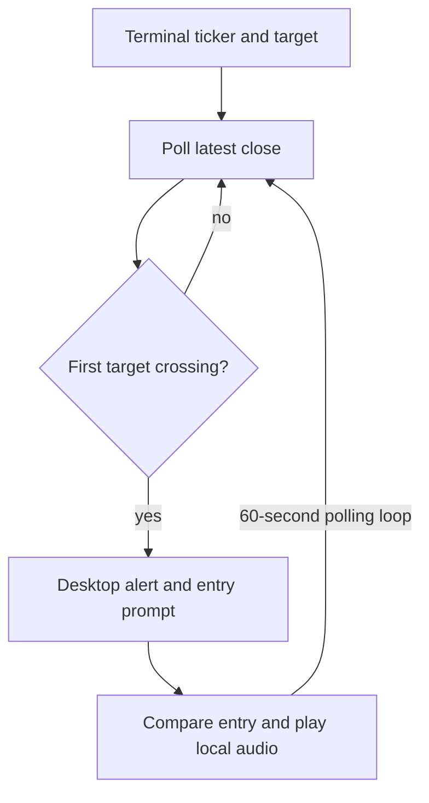

# Chart Tracker — desktop price-crossing script

**An interactive Python script that samples a ticker's latest one-minute close and raises a local notification when it crosses a user-entered target.**

This small learning project makes a polling-and-alert loop visible from the terminal. It is a supporting project, not a quantitative trading system or automated execution tool.

- Prompts for ticker and target price.
- Compares consecutive yfinance samples for an upward or downward crossing.
- Requests a buy/sell label and entry price after the first crossing.
- Plays local Win/Lose MP3 audio based on subsequent entry-price comparisons.

**Author:** Albert Mejooli; [implementation history](https://github.com/Albert-bit07/Chart-tracker/commits/main/Project%20Stock%20reader.py). **Stack:** Python · yfinance · pygame · plyer.

## Flow



Source-derived illustration. The single [Python source](Project%20Stock%20reader.py) holds state in local variables. Only the first crossing triggers the entry prompt. After entry, audio plays only when the position changes between win, lose or break-even.

## Run

Use a desktop Python environment with an audio device, notification support and internet access. From this repository root:

```bash
python -m venv .venv
# Activate your environment for the current shell.
python -m pip install yfinance pygame plyer
python 'Project Stock reader.py'
```

Install dependencies with `python -m pip install -r requirements.txt`. Audio assets resolve relative to the script; audio initializes only when needed and is optional. Dependencies are not locked. Enter a ticker and numeric target, then wait for an actual crossing. After the notification, enter Buy/Sell and the entry price. Ctrl-C stops the script.

## 60-second demonstration plan

Show the prompts, the previous/current crossing condition in source, and the polling loop. If a live crossing occurs, show the actual notification and audio behavior; otherwise label the walkthrough as source-only. External market data and a one-minute polling interval do not guarantee a short live event. Do not fabricate a crossing, screenshot or terminal transcript. No recording or runtime capture was produced during this review.

## Scope and limitations

There is no authentication, API, database, order execution, backtest, model, job recovery or profitability measurement. Network failures and empty/invalid quotes are logged and retried; numeric inputs are validated and desktop/audio failures are nonfatal. A crossing can be missed between samples. The data source is external and does not establish real-time exchange latency. Restart loses state. The script blocks for input on first crossing and pauses polling while collecting entry details. It should remain a local experiment.

A separate [ChartTracker API](https://github.com/Albert-bit07/charttracker-api) adds an HTTP entry point and alert cooldown, with its own background-task limitations.

## Validation — 2026-10-20

The Python file parsed successfully with AST. yfinance and pygame were not installed, so no provider request, desktop alert or sound playback was executed. No tests, CI workflow, benchmark or AGENTS.md was found in the checked tree. Favor the larger systems/application projects for recruiting and keep this repository as a clearly scoped learning artifact.

## Regression checks

`python -m unittest discover -s tests -v` passes five tests covering finite positive inputs, crossing boundaries, failed-quote recovery, audio state transitions, short positions and break-even. Market data, notifications and audio are mocked. Importing the module no longer prompts or opens an audio device. No live provider or desktop E2E result is claimed.
